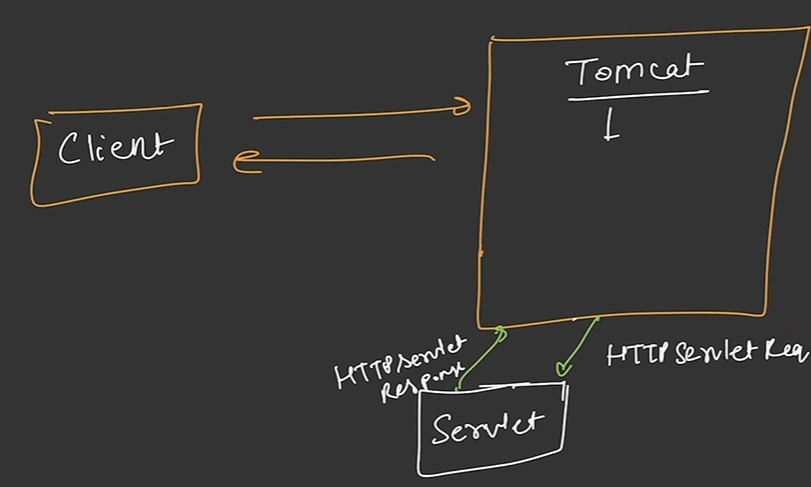
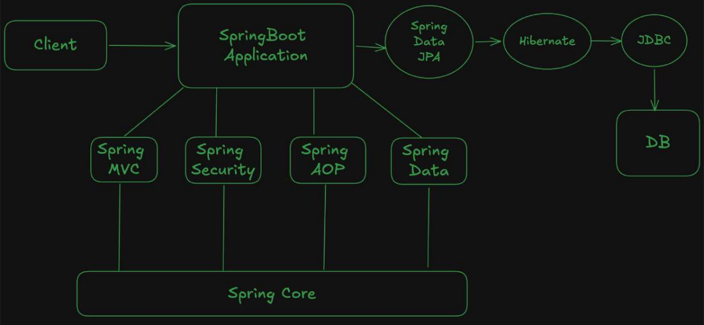
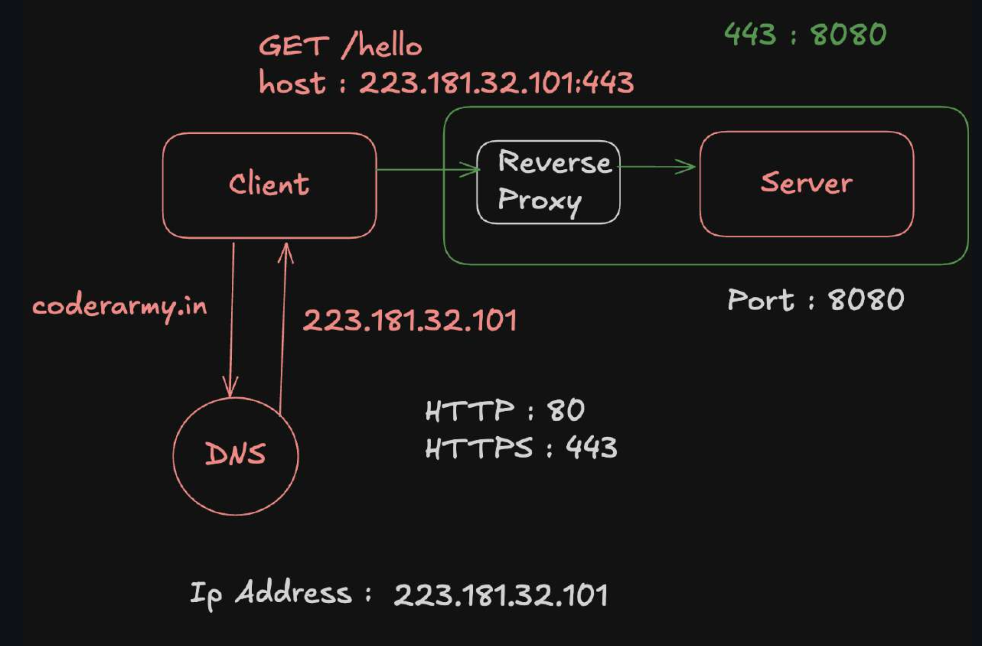
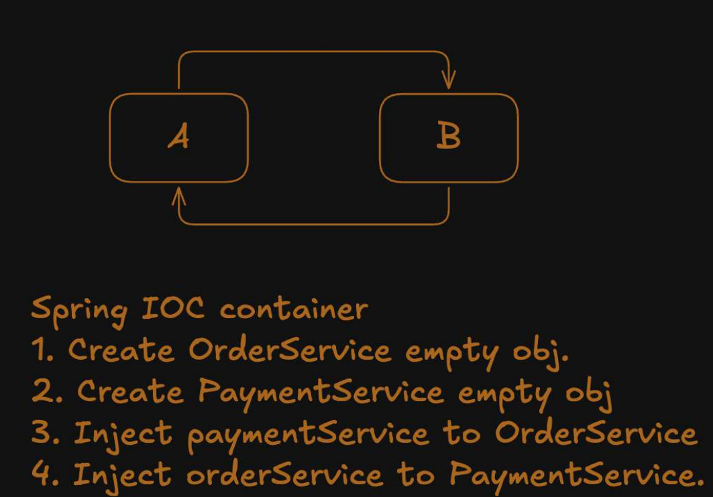
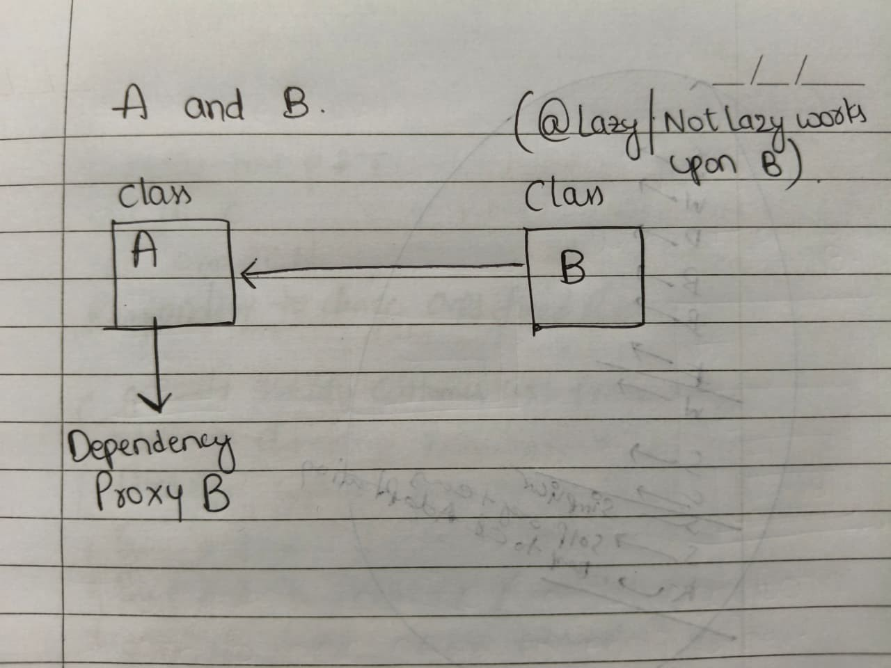
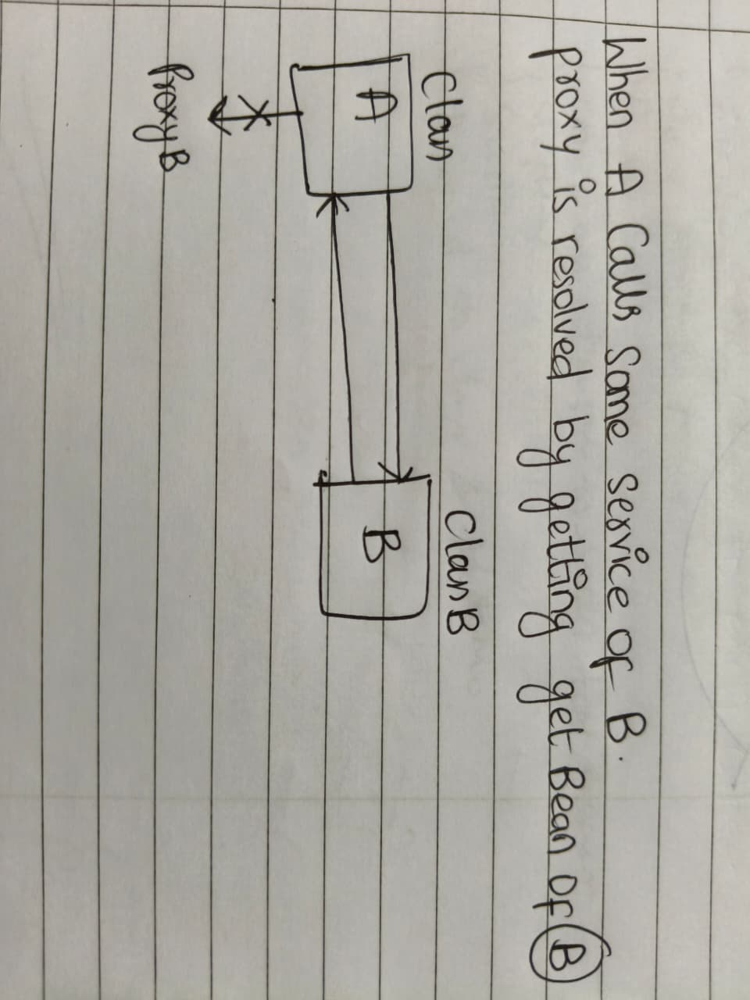
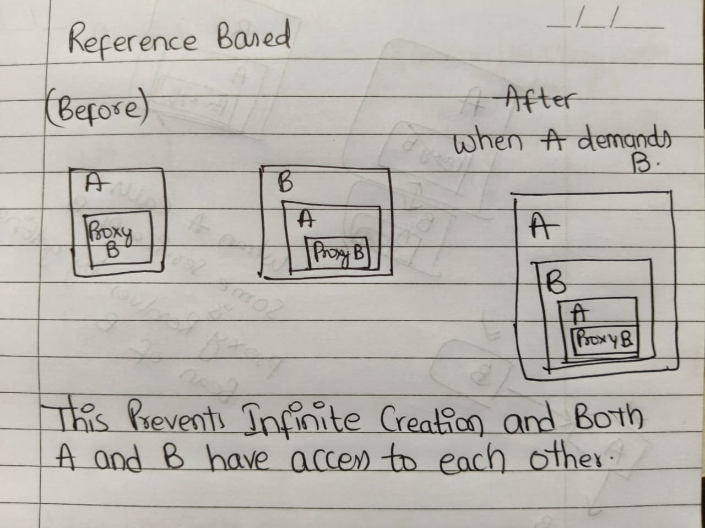

## Client Server Architecture

**Clients** (Browser, Mobile App, postman, server as well can be clients) communicate with servers for response  
* HTTP is standred protocol (Rule book, Guidelines, Standardization for communication) for Requests and Responses  
  * Request Structre (Method,Host, Path, Http Version, Headers, Body)
  * Response Structure (Status code, Headers, Body)
  * Meaning of GET, POST etc
  * How the data is sent (HTTP / HTTPS)

---

## Why not use Core Java ?

**Core Java** can be used to build applications, with help of sockets and server sockets that listen to some port (core java functionality)  
Listening a network request on a port 
```java
ServerSocket server = new ServerSocket(8080);
```

### Problems Which make Development very hard in core Java
* Java Sockets read request in form of streams i.e manual conversion into HTTP Request and Response
* Manual URL / Route Parsing 
* Mapping a method to an endpoint route 
  * Huge Else if Ladder for Mimicing conroller
* This all is done through main thread and other requests have to wait, manual multi threading has to be done.
* Huge Boilerplate code to be written

## Introduction of servets and servlet containers

**Servlet container** we call it as **Server** This also listens Networking request but also performs the Stream to HTTP conversion and boilerplate problem
* Calls Appropriate Servlet for a route (Mapping problem)
* Manages Threads (No manual Multithreading)
* Tomcat is famous servlet container. keeps listening for requests.

* servlet container calls servlet based by parsing the route (eg /api/login) and chooses servlet 
* Servlet is Java Class which handles request one request is sent to servlet (Class basically)
  * GET  → doGet()
  * POST → doPost()
  * PUT  → doPut()
  * DELETE → doDelete()



## Problems and Need for Spring Framework

> When Servlet code is scaled to some enterprise level, The code is tightly coupled. 
* Manual creation of objects  
* Controlling the flow of execution 
* Changing a existing code feature would require touching code in large codebase, breakage and expensive bug fixes
All these make code Tightly coupled

## Spring Core 
It is Concept, Ideology (Dependency Injection, Inversion of control, Beans) Assumes a Configuration reduces boilerplate problem further 
solution to Tightly coupled problem.  
The spring MVC, Spring Data, Spring security all are based on spring core 

## Spring Boot 
This is Opinionated system (provides default config), This is build upon the services (Spring MVC, Spring data..)
* Internally uses servlets and modren spring a single servlet exists for req and response handeling (Evolution from many servlets to one)
* from Dispatcher Servlet the request enters Spring MVC.
* some other sevlets like default servlet for static (HTML, CSS) files and custom servlets etc.




### Port 
Just as IP address is used to identify device, Port number is used to identif application inside device.  
socket is object maintained by os which has port mapping and related information.  

### Dependency
library On which my code depends becomes my Dependency. External library required by my project 

### JAR Packaging - (Java Archive)
Containes Our code as well as setup code to run our application, so that we can have communication between server and application.

## Proxy
A server That sits beteween another server and forwards requests
* Forward proxy or proxy
* Reverse Proxy

``` text
Client -> Proxy -> server  
```
if proxy is working for user its forward and if its working for backend its reverse proxy  


Main Use cases of proxy:
* We configure Proxy for many clients so that we can Hide internal Ip's and this only represents the ip of proxy  
* Controlling what clients can request for
* Caching between requests of clients  

Simple reverse proxy is also the same 
``` text
Client -> Proxy -> server  
```

Main Use cases of reverse proxy:  
* It works for server, Hides the ports of backend Server, Topology i.e how backend is organized.
  * **DNS contains domain to Reverse proxy IP not servers** so that the rules can be enforced and actual ip is hidden.
  * core usecase of proxy is to make attackers/users cannot directly connect to your backend service and bypass the proxy's controls.
* Decides what server to handle a request. and also acts as load balancer if more instances are there.
* HTTPS encrption and decrption and forwards HTTP request.
* Rate Limiting
* Caching of responses that include (Static files like images, CSS, JS).


if Huge Application we can use multiple Reverse proxies and load balancer 
``` text
Clients
   ↓
Load Balancer
   ↓
RP1   RP2   RP3
 ↓     ↓     ↓
Backend servers  
```
Reverse proxy do jobs like caching, rate limiting, load balancing, Routing (configuration if its microservice)
Load is further reduced for Reverse proxies with load balancer and no need for extra activities on above layer so dedicated load balancer is enough and suggested.

## Client server detailed 


## JAR (Java Archives)
uses similar to zip files and bundles java .class files, Images/Resources, metadata  
like mainfest.mf which tells entry point of jar file  
```java
java -jar file.jar
```

## Artifact 
Final packaged file produced after build phase of an application, that can be used, shared or deployed

## Library JAR vs application JAR
Library Jar is not executable in itslelf and generally does not contain the dependency jars installed, maven have to install from its pom.xml which maven does when we press sinc button. (resolve transitive dependencies)  

Application JAR is executable and contains/bundles all library JARS with it.its complete.
it Has all library jars bundled and independently executable. 


## Maven

Tool which we can manage Java/Spring Projects, Downloading of dependencies, Transitive Dependencies, Providing lifecycle of project, 
which includes the processes in all phases like verify,compile etc.  

Reduces manual effort of maintaining project

## Plugin
is Code that maven uses to perform some functionality 

## What is Build phase in maven Life cycle 
Entire process of Lifecycle is build phase which maven automates and we get target folder as a result which has .class files and .jar file

## Phases 
```text
clean -> independent phase used to clear target folder that contains .class and/or .jar (previous build phase result),
tip -> we generally combine and use clean initially "mvn clean install" like wise
Validate -> Checks the structure and checks weather the pom file is valid or not  
Compile -> compiles the java code   
Test -> unit tests  
Package -> Process of converting your application code into .jar file, bundling it, Distributable format 
verify -> integration Tests 
install -> save in local repository the M2 Folder
Site -> some documentation related
Deploy -> to central or remote repository
```

## pom.xml (Super, Parent, effective)
Maven uses pom.xml file as this file contains all dependencies, plugins, meta data of project  
Super -> parent of all pom files contains default configurations  
Parent -> The immediate parent pom.xml from where you are inheriting   
Effective -> the effective configurations of pom.xml code from all the chain from super pom to your pom.xml  


## How Maven searches for a Jar (Local Repository, Remote, Maven Central Repository)
First checks in local computer inside /M2 folder basically the cached jar files if not found here it eaither searches in Remote if specified if the code belongs to some organization or maven central where all repositories are published.

## Maven Archtypes 
its maven templates of projects for a quick start. 


## Tightly Coupled Design
* Insted of maintaining abstraction you specify details in our code i.e Not coding for interfaces
* When one part of code is changed the other part is also forced to change (Tight coupling) 
* Harder to maintain, code breakage risk is high.
* As some services are costly to test we create simple test services which also require to be changed in Tightly coupled system


* Better way of Dependency injection is constructor injection (java) were just main func has the control and Tight coupling is reduced.
* so Tight coupling is reduced not eliminated, so comes concept of IOC and Beans

## Inversion of control 
* We (spring core) is taking the control from main, eliminating tight coupling and it manages objects and injects where ever necessary
* so control is in IOC container now which passes dependencies to services.
* before the control stays inside main, now IOC container does all by maintaining beans (i.e creation of dependencies, lifecycle of dependency object, configuring dependencies of dependencies)
* This is called IOC, Using IOC + DI + coding for interfaces we can eliminate tight coupling 

## Loose coupling 
* Maintaing Abstraction i.e coding for inrterfaces so that code is following solid principles.
* Easier Unit testing, No changes in src code required for change of features


## Java Reflection API i.e Using <class_name>.class in spring code

This is used where Spring has to manage object. it should have all the details of class, so passing object is not useful to get all the class information, so special object of `Class` Type is used. so that Spring has all the information, also used in Exception catching in @ExceptionHandler
```java
Base Syntax
Class<AppConfig> config = Appconfig.class
```

This is one of thing that internally may happen when we do SpringApplication.run(AppConfig.class, args);  
`ApplicationContext context = new AnnotationConfigApplicationContext(AppConfig.class)`  


## @Configuration Annotation 
For IOC container first it goes to class with @Configuration, @ComponentScan (good, when we mention path as well) Happens and All the classes with @RestController, @Service, @Component it creates beans and then @Beans mentioned in the class are added to IOC container.  

In Conflict of spring bean from component scan spring chooses from AppConfig (What we describe has priority).
Only When it matches exactly i.e the Bean name and Component Class name and return types.  

@Qualifier, @Primary, @ConditionalOnProperty are used to help spring to choose bean when there are more than one of it in IOC.  

primary and qualifier helps in picking one from container where @ConditionalOnProperty if used everywhere only one bean would be maintained in container in first place.  


## Steps from Start of Application To spring beans creation 
1. Start the spring Container (Ioc container)
2. Spring reads the class with @Configuration (AppConfig.java mostly)
3. Spring processes @ComponentScan
4. Spring finds @Components, @Services, @RestController
5. Spring creates Bean Definitions (Maintaines Meta data, bean name, class, scope, dependencies) (Spring has to maintain bean as well so this step is necessary, later bean is created)
6. Spring starts creates beans

## AppConfig is also a bean

```java
@Configuration
@ComponentScan
class AppConfig{
 @Bean
 public User getUser(){
  return User(20, "Arbaz");
 }
}
```
In order to call the functions and get the objects AppConfig should also be a spring managed object
@Configuration is internally having @Component, Class meta data is also passed (AppConfig.class) and Bean as well. 


## Circular Dependency 

This is a state arises when there is circular chain of dependencies are there.  
**Spring when used with Constructor injection:**  

Not possible and Exception of `BeanCurrentlyInCreationException` because at the time of creation we need the dependency object

**Spring when used with Field or Setter injection:**
This can be possible because, consider A <-> B circular dependency the steps would be 
1. Create Partial object A without any dependency injection
2. Finds B is required so Creates partial B object
3. Finds A is required and partial A object (which is present) is injected to B making it complete
4. The Complete B object is injected to A making A complete

Circular Dependency can be resolved in spring core, but highly discouraged in spring boot and in default
`spring.main.allow-circular-references=false` configuration so its not allowed until its changed.  

Circular dependency existence means violation of Single responsibility principle and wrong design approch is used. some class is taking responsibility that is shouldnot take, and should properly break down.

Although there are methods to resolve, Circular dependency should not exist in the first place.

## Singleton scope in Spring
* Same Reference is passed (default no need of @Scope("singleton")) from context.getBean(X.class) or Dependency injection. 
* Note : One initial object is created at beginning regardless of any dependency. 
* Uses Eager Initialization

## Prototype scope in spring
* New Reference (Object) is passed when @Scope("prototype") eaither from .getBean() or Dependency injection.  
* Note : No initial object is created. Creates new when ever requested from .getContext or Dependency injection.
* Uses Lazy Initialization


## Important Fact on Singleton pattern (single per class) vs Singleton Scope (single per bean definition)
```java
@Configuration
public class AppConfig {
    @Bean
    public OrderService order1() {
        return new OrderService();
    }
    @Bean
    public OrderService order2() {
        return new OrderService();
    }
}
```
Every bean definition has a Bean, here order1, order2 different bean names lead to different bean definitions.  
so 2 Beans of OrderService may exist in IOC container, with different definitions with same Return type (just to make sure you remember that still the Some [Qualifier, primary] annotation should be used because even if they are different definitions of beans, conflict of which bean to pass in DI or .getBean() is still there).

## Singleton vs Prototype prefered way

* Singleton -> stateless (service/feature/functionality that dosent depend on state (i.e data) and task oriented)
* Prototype -> stateful (Service which remembers a state) 

## Bean Initilizations
* Singleton -> Eager Initilization (default initilization)
 * whenever Application is up, beans are created. 
* Prototype -> Lazy Initilization (default initilization)
  * whenever we ask weather from .getContext() or DI then its created.

Singleton can become Lazy with @Lazy annotation  (Creation of single bean can be at start of app (Eager) or when required (Lazy))
Prototype cannot be Eager (Why to create when application is up when new object is passed everytime no sense)


## When Eager can force Lazy beans to be created

```java
// default singleton
class UserService(){
  UserService(PaymentService paymentService){}
}

@Lazy
class PaymentService{}
```
This forces lazy to be created as Eager initilization demands, but the UserService is not used yet.

### Optimization 
```java
class UserService(){
  UserService(@Lazy PaymentService paymentService){}
}
```
Proxy of user is added (Not actual User but a dummy) and when actual demand comes from service the lazy is created. 


## Note
when lazy just over payment service its useless because Eager in order service makes demand at the beggining itself, lazy in just parameter is also useless because the bean is created anyway and proxy object is still added no optinmization but breaks circular dependency (discussed below), so both Lazy makes sense.

### More Formally
Class-level @Lazy delays automatic creation; parameter-level @Lazy delays resolution at the injection point. Together, they let the dependent singleton start without forcing the lazy bean to be created


### Proxy definition here
* A middlman that helps not to force Lazy and not to disturb the constructor DI. when something tries to access proxy, then demand comes.
* when something tries to call proxyObj.someMethod it internally does .getBean() creating demand there and gets Bean.
* so proxy is also a dummy implenmentation of interface and placed there (lightweight implementation )


### `spring.main.lazy-initilization = true` 
Every thing is Lazy, all the beans and whichever i want not to be lazy i do @Lazy(value = false)


## How Lazy resolves Circular Dependency 

Assuming 2 Classes, A and B. Circular dependency.
```java
class A{
 A(B obj) {...}
}

class B{
 B(A obj) {...}
}
```

### with @Lazy
```java
class A{
 A(@Lazy B obj) {...}
}

// placing @Lazy here, will create only when required injects A's Object with B's proxy as dependency
// Not placing @Lazy here, A bean is created first with B's proxy and B gets that dependency and B is created Eager-ly.
class B{
 B(A obj) {...}
}
```


### Images for clarification 
Initiall relation
* if B is Lazy -> B is created when A's Proxy B is invoked. and Resolves immediately
* not Lazy -> as A is now independent with B's proxy, B is created with A's Bean.
  * only when A invokes Proxy B that resolves into already present B's Bean.





## Bean Life Cycle (General Singleton and Eager)

```text
 IOC Container Starts
         |
 Read Configuration
         |
 Read Bean Definitions                     Bean Definition:
         |                                 BeanName: orderService 
 Instantiate/Create Objects                BeanClass: OrderService 
         |                                 Scope: Singleton
 Dependencies are Injected                 lazy: false
         |                                 dependencies: paymentService 
 Aware Interfaces are called              
         |                                 Aware Interfaces for Logging BeanNameAware, ApplicationContextAware
 Initilization Callbacks         
         |                                  Initilization Callbacks (With Order of chronology):
    Bean is Ready                           1. @PostConstruct 
         |                                  2. InitilizingBean (Interface)
   Destruction Callbacks                    3. Init Method upon @Bean
         |
   Bean is Destroyed                       Destruction Callbacks (With Order of chronology):
                                            1. @PreDestroy
                                            2. DisposableBean  
                                            3. destroy Method 
```

### Why not use Constructor insted @PostConstruct  
Becuase we dont have Eough Information At creation phase, Later all the dependencies are injected we have all the information  
@AutoWired, @value etc.
### Constructor DI can solve this same right then?  
its prefered to keep constructor Lightweight and bean creation lightweight. so @PostConstruct is used. 


## Lazy In singleton and Prototype bean Lifecycle
Lazy in singleton is exactly same but the object creation is upon demand of any other dependency or .getBean() call  

### Prototype Bean Lifecycle  
```text
 IOC Container Starts
         |
 Read Configuration
         |
 Read Bean Definitions                      
         |                                 
 Instantiate/Create Objects    (Assuming there is demand for the creation)
         |                                
 Dependencies are Injected                 
         |                                
 Aware Interfaces are called              
         |                                  
 Initilization Callbacks         
         |
 Object is handover to client    Why? To save from Memory leaks.  
```

### Memory Leak
Memory which is reachable but not needed by the program.  
If its not even reachable its candidate for Garbage Collector.

### Bean Initialization in Prototype
Container Management: Spring manages the creation, dependency injection, and initialization of prototype beans, but does not manage their destruction.

The Catch: Once Spring hands a prototype bean over to the client, it discards its reference. Because of this, destruction callbacks (@PreDestroy, DisposableBean) are never called by the IoC container. If a prototype bean holds open connections or heavy resources, the client code must clean them up explicitly to prevent memory leaks.

### Memory Leaks handling
To prevent memory leaks in Java / Spring Boot:
1. Remove unused references: map.remove(id) when you're done with an object.
2. Close resources: Use try-with-resources for files, streams, and other AutoCloseable resources.
3. Limit collections and caches: Don't store objects forever without a reason.
4. Clean up listeners and ThreadLocal values when they are no longer needed.
