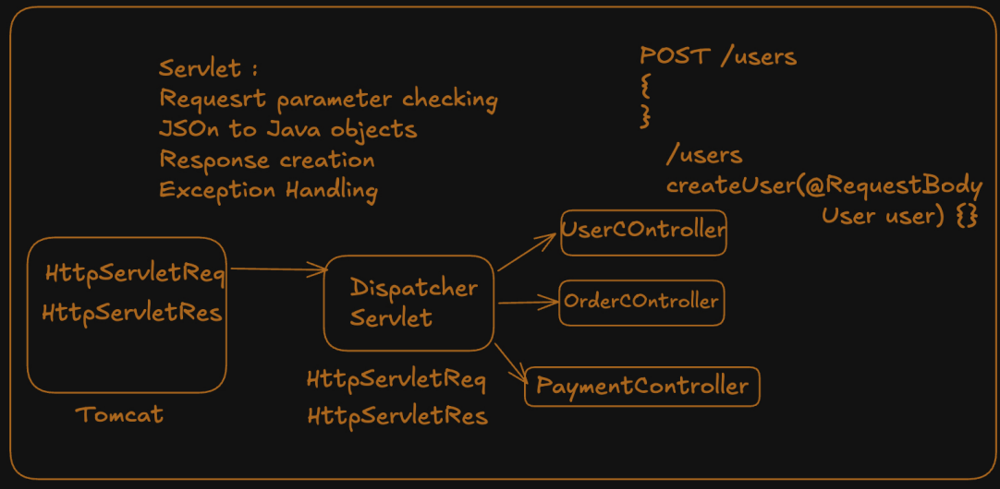
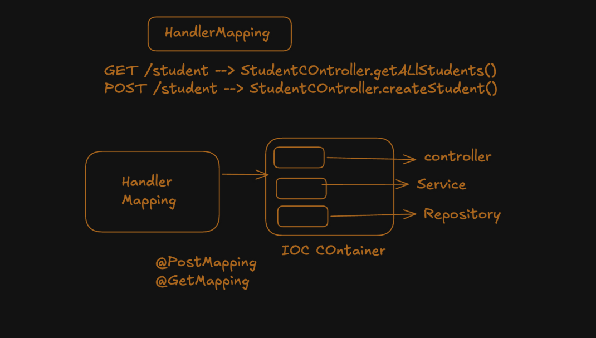
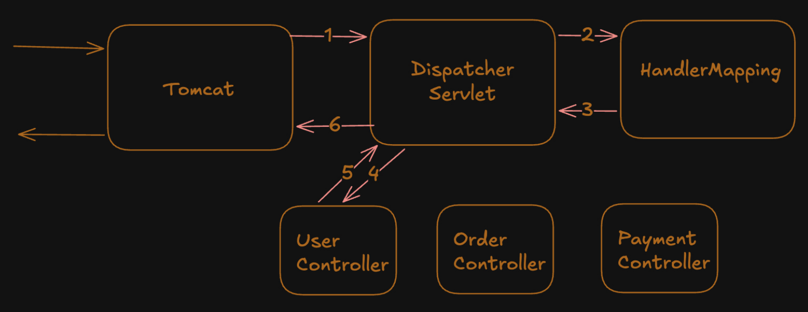

## @Entity 
@Entity is simply tells that the below class fields maps to table of some db and its objects will be mapped to rows of the table.  
@Entity also requires a no args constructor similar to jackson to create objects and the data are injected through reflections or field.

### Request Flow to controller 
Request with JSON data, it is converted into java object. and @Valid makes validation checks and after that it proceeds to controller

### How Jackson Converts JSON to java object
It creates object with No Arguments Constructor and injects with setters or fields.  
So NoArgsConstructor is necessary and setters are good practise. (Jackson can access privates through reflections(need not to think for now))


## Methods provided by Spring JPA (jakarta persistence api)
1. create/read -> save()
2. search many or one-> findAll() and find()
3. delete -> deleteById()
4. exists -> existsById()

### Why a interface in repository layer ? 
if there would be a class we have to manually write the query logic. Interface we define. common signatures are already provided like (listed above).
and custom method signatures we define inside interface.
at runtime JPA provides us the implementation of the repository layer methods implementations.

### Error when running newly created spring app due to @AutoConfig of database connection ?
@SpringBootApplication(exclude = {DataSourceAutoConfigiration.class})

### Configuration of application.properties for DB connection 
```text
spring.datasource.url=`url`/dbname
spring.datasource.username=***
spring.datasource.password=***
spring.jpa.hibernate.ddl-auto=***

spring.jpa.show-sql=true
spring.jpa.properties.hibernate.format_sql=true
```

## Pagination in Spring Boot

* Insted of Querying everything, we take required chunks using pagination
* With Query Params we can control how the chunk can be displayed (Filter, sort, etc)
* @PageableDefault is default values when Queryparams are not sent

```java
@GetMapping("/data")
public Page<DataDTO> getPaginatedData
(@PageableDefault(size = 10, sort = "fieldName", direction = Sort.Direction.ASC) Pageable pageable) {
 return dataService.getData(pageable); // Delegates pagination to the service layer
}
```
For Soft delete + pagination in Repository layer
```java
Page<Student> findByIsDeletedFalse(Pageable pageable); // isDeleted is Boolean in Entity
```
Rule of thumb is use JPA Naming as you were using before, To introduce pagination just pass Pageable class in parameter in Spring JPA Repository.

For Configuration in application.properties for default and max page size
```text
spring.data.web.pageable.default-page-size=20
spring.data.web.pageable.max-page-size=200
```


## Core Java For Web Applciations 

Applications can be made in core java, Everything is manual even before you write a single line of code of business logic   
Main/Core Problems :   

* Understanding the HTTP request (Metod, Path, Headers, Body) its just a stream, i.e String
* Mapping Route to Correct Method. Huge Else if Ladder


### Problems when Core Java


### Servlets and Beans  
before servlet and servlet container, servlets are special java class objects whom servlet container manages and invokes upon a request. This idea of Inversion of control leads to spring IOC container and beans.  
* Servlet is java class that handles HTTP request and generates HTTP response
* Servlet container creates, manages, Invokes servlets, manages their life cycle (init(), service and inside doGet() etc, destroy())
* Insted of you controlling (creating, Invoking, destroying) the servlet The control is Inversed to Tomcat.


Beans and servlets are similar cuz both are created and managed by servlet container/spring. And to reduce further tight coupling Dependency injection is added. in evolution of servlet & servlet container to spring core.  


## JAR vs WAR ( Java Archives vs Web Archives )

War packaging is used with servlets, the application's compiled code, dependencies and resources like (HTML, css, js files) are packaged, usually war is used to be deployed in external tomcat server. War is servlet class based.

Simple JAR is similar to WAR but JAR can be Executable JAR that can contains your compiled code, Embedded Tomcat JAR as well. and is standalone executable.

### External Tomcat 
We can deploy more than one application in external tomcat and to communicate the route is 
`http://localhost:8080/app-name/route-starts-here`


* This External tomcat upons request calls init() initially (similar to @PostConstruct)
* Then service() which internally resolves to some method like doGet, doPost etc.
* Then destroy() is called similar to @PreDestroy

### Simple code Example for Servlets 

```text
In pom.xml,

<packaging>war</packaging>

<build> <!--  As Name is hectic use this for deploying in Tomcat. -->
    <finalName>servlets</finalName>
</build>

Tomcat 9 or below
<dependency>
            <groupId>javax.servlet</groupId>
            <artifactId>javax.servlet-api</artifactId>
            <version>4.0.1</version>
            <scope>provided</scope>
</dependency>
Tomcat 10 or above You can use Jakarta Servlet API from MVN repo.
```


```java
package dev.arbaz;
import tools.jackson.databind.ObjectMapper;
import javax.servlet.annotation.WebServlet;
import javax.servlet.http.HttpServlet;
import javax.servlet.http.HttpServletRequest;
import javax.servlet.http.HttpServletResponse;
import java.io.IOException;

@WebServlet("/home")
public class DemoServlet extends HttpServlet{

    @Override
    public void doGet(HttpServletRequest request, HttpServletResponse response) throws IOException {
        Integer name = Integer.valueOf(request.getParameter("name"));
        response.getWriter().write(name + "The Response");
    }
    @Override
    public void doPost(HttpServletRequest request, HttpServletResponse response) throws IOException{
        Integer name = Integer.valueOf(request.getParameter("name"));
        ObjectMapper mapper = new ObjectMapper();
        User user = mapper.readValue(request.getReader(), User.class);

        response.getWriter().write(user.getId() + " " + user.getName() + " The Response");
    }
}
```

### Deploy to External Tomcat server 

* We can Install Tomcat from `https://tomcat.apache.org/download-90.cgi` and download from `32-bit/64-bit Windows Service Installer (pgp, sha512)`  
* Generally the path where Tomcat is located is 
`C:/Program Files/Apache Software Foundation/Tomcat 9.0/`  
First paste the .war packaged app into /webapps and New folder is automatically generated then:  
* To Run or start the server with out logs we can do from run (win + r) then `services.msc` and search tomcat and right click and start/stop.
* For logs as well, open Terminal navigate to the above path (use cd "Program Files/" use " ") and run ./bin/startup.bat or ./bin/shutdown.bat


## Purpose of Dispatcher Servlet 

Servlet container does a lot of work to reduce boiler plate, Tightly coupled code. Why a seperate dispatcher servlet, why not just put in Tomcat itself ?  

* Some times when parsing request or generating response you might need to interact with spring.
* Example for that is say form HTTPServletRequest To directly provide in parameters of spring.
*  converting request body to object it needs Jackson bean (understand spring auto configured beans and normal as well).
* Spring placed a dispatcher servlet and introduced controllers.


* Its Like Tomcat manages (Parsing) Reqest to HttpServletRequest and forwards to Dispatcher servlet and same for response.   
* Dispacher Servlet manages HttpServletRq to Objects,Forwarding to correct controller (before tomcat does this in servlets) and Generating JSON response from spring response.  
* From Controllers the request can navigate to business logic (Service and Repository).   

* So it will be clear if me map to methods (base route in class then in methods) insted of just to class (in servlets), To understand the spring code like @GetMapping, the invokation is in hands of dispatcher servlet, back then it was to classes so Tomcat does this.
* Dispatcher servlet -> {HttpServletReq to Object via beans, invoking methods by understanding @Annotations, generating JSON response body etc} so that it can understand spring code. and seperate of concerns and Embedded tomcat need not to take care of this.

So its like evolution from servlets and servlet container to servlet container -> dispatcher servlet -> controller/service beans.

dispatcher servlet makes the tranistion from HttpServletRequest and same for response as well to accessable in parameters directly of spring mvc, understands beans cuz it creates json request body to java object via jackson bean which is i guess a autoconfigured bean in spring boot, it handles routing as before it was sevlet routing just to a class, now based on base route of bean class and route of methods, Dispatcher servlet can select bean. it can understand spring code of annotations thats the reason this functionality is seperate from tomcat server , seperate of concerns , validations as well and exceptions as well when validation fails.This is the reason this are all handled here i.e Dispatcher Servlet.


### Why Dispatcher servlet and Controllers and why not dispatcher servlet to servlets
why servlets were reduced to dispatcher and controllers were used ? becase of their structure how they accept HttpServletRequest , the problem will still be there of converting from HttpServletReq <-> java obj and java obj <-> HttpServletResponse and validations so further dispatcher servlet and controllers were introduced insted of dispatcher servlet to servlets  

Through controllers, the work done by dispatcher makes controllers lighther. 

### Scope Provided in dependency in pom.xml

We use classes like 
* HttpServlet
* HttpServletRequest & Response

These are already provided by the runtime tomcat, Use for compilation . so dont add these in final .war packaging because environment will provide it.  

`<scope>provided</scope>`  

Maven uses default scope compile. it packages Jakarta Servlet API (Tomcat 10 or above) inside final war.  

Now because there are 2 copies exist of servlet api one in tomcat/lib and one in app.war this creates class loading conflicts or runtime issues.  

In container based applications the container should provide the API's and not packaged by application

### Servlet Lifecycle
* Servlet is created upon the first request arrival init() (This is default behaviour) and later on service() which maps to doGet() etc.Finally destroy(). 
* Their idea maps to spring
* init() -> @PostConstruct
* destroy() -> @PreDestroy

### Usage of servlets
Servlets are created once and reused. we should be careful with the instance variables inside servlets, when multiple users are sending requests.

### Embedded Tomcat
We get embedded in spring-boot-starter-web dependency, when we do `SpringApplication.run(App.class, args)`

 * main() starts
 * Spring boot starts (IOC container etc)
 * Embedded Tomcat server starts and app is ready
 
 ### Spring MVC idea
* Request reading, response writing (from HttpServletRequest), Validation, Routing to correct method (understand spring annotations @GetMapping etc...), Error Handling and business flow of controllers <-> service starts. Repitive tasks are handled and one servlet is used.
* so writing servlet code was harder so dispatcher reduced that and spring mvc better cleaner framwork, some architectural changes made that were necessary with dispatcher servlet. routing to methods insted of class + service methods like doGet() etc

### Major changes from servlets to spring MVC
* Dependency Injection (Major problem of Tight coupled code)
* routing to methods directly from dispatcher servlet
* HttpservletRequest to params and parsing req body
* Validation in dispatcher servlet and when fails then exception raising
* generating JSON response from Java Objects 


## Spring MVC 
This is actual web framework that uses spring core To Manage web applications, core spring gives Base framework, the ideology.  
@Beans, Dependency Injection, IOC container and Spring MVC gives extra functionality for web apps like, @Controllers, @Service, and web related functionality.  



You can build everything using only servlets but the boilerplate of class UserServlet { doGet(HttpServletRequest,HttpServletResponse) etc.} to eliminate this servlets and insted controllers are used.

### Handler Mapping 
 * handler mapping it scans all beans and their annotatiions, creates route to method mapping and helps dispatcher servlet to call correct bean.  


### Data is extracted/resolved in requests
* Request Body is extracted by dispatcher servlet via Jackson Library JSON <-> java object mapping and provides controllers.
* Query Params are Extracted by tomcat and placed inside HttpServletRequest dispacther servlet provides controller from there.
* Path Variable While HandlerMapping Lookup by dispatcher servlet for Route the dynamic variable is mapped with req value and controllers can access.


From creating of HttpservletRequest from raw string by tomcat, Later Dispatcher servlet takes those objects gets method mapping and resolution values from HandlerMapping for @Path variable. it can do like use jackson to convert json <-> java object later validations and exceptions as well, the dispacther servlet Fills the required arguments of controllers.  


### Request Flow and Response Flow

### Client to Controller
* Tomcat parses HTTP request to HttpServletRequest (request body is still a stream)
* Dispacher servlet convert the stream request body to Java Obj via jackson, Finds method from Handler Mapping (Here @Path Variable is resolved in path matching, @ Req params is already done by tomcat inside HttpServletRequest) and invokes the controller method with passing arguments
* Handler Mapping Finds The matching method, and spring mvc'c component resolves the @RequestParam (even its there in HttpServletReq) and @PathVariable is identified in handler mapping but resolved by spring mvc to params of controller.
* Controller recieves through parameters

### Controller to client
* Controller : We generally return a ResponseEntity which has Statuscode, headers, body (Java Obj)
* Dispatcher Servlet : Converts That Java Object to JSON (with spring mvc components coordination i.e jackson) +  headers + status code placed in HttpServletResponse
* Tomcat Sends HTTP Response from HttpServletResponse Object.


## Spring MVC 

The Boiler Plate Code 
```java
public class Main {
    public static void main(String[] args) throws LifecycleException {

        // Boiler plate
        Tomcat tomcat = new Tomcat();
        tomcat.setPort(8080);
        tomcat.getConnector(); //

        String contextPath = ""; // Path of Your App when Using External Tomcat, just because its embedded its empty
        String baseDoc = new File("src/main/webapp").getAbsolutePath(); // Path For Web Apps folder where Files related to App are there (JSP, HTML, etc). 

        Context context = tomcat.addContext(contextPath, baseDoc); 

        // IOC Container app
        AnnotationConfigWebApplicationContext springContext =
                new AnnotationConfigWebApplicationContext();

        springContext.register(WebConfig.class); // To Create Beans 

        // Dispatcher Servlet
        DispatcherServlet dispatcherServlet =
                new DispatcherServlet(springContext); // DS can Call Those Beans

        Tomcat.addServlet(
                context, "dispatcherServlet", dispatcherServlet);

        context.addServletMappingDecoded(
                "/", "dispatcherServlet"); // Forward requests starting with / to dispatcher servlet

        tomcat.start();
        System.out.println("Tomcat started on port 8080");
        // keep server running
        tomcat.getServer().await(); 
    }
}

```
### Evolution 
Spring Core and Spring MVC reduced boilerplate compared with manual Java and Servlets.
Spring Boot further reduces Spring configuration and setup boilerplate through auto-configuration.
```text
Servlets
  ↓
Spring Core
  Dependency Injection + IoC
  ↓
Spring MVC
  DispatcherServlet + Controllers
  Request/response handling
  ↓
Spring Boot
  Auto-configuration
  Embedded Tomcat setup
  Dependency management
  Easy application startup
```

### @RestController vs @Controller 

Spring MVC was Built for web applications and it means M - Model, V - View , C - Controller   
Views are Java Servlet Pages which are just HTML + java injection and model is an object that takes data from controller to Views.  
src/main we have webapps folder for JSP pages. and @controller is used to serve them. 

when we do `return` in @Controller it searches for JSP pages provided in `baseDoc` and returns the prefix `contextPath` + returned Value + `.jsp`  
When I write @ResponseBody, I tell that insted of JSP, write directly inside HTTP response Body

```java

@Controller
@RequestMapping("/")
class Greet{
   @GetMapping
   public String greet(){
    return "hello"; // hello.jsp
   }
   @GetMapping("/hello")
   @ResponseBody
   public String greet(){
    return "hello"; // Write directly to HTTP response, If java object is sent? it converts to JSON.  
   }
}
@Controller + @ResponseBody is @RestController.
```
