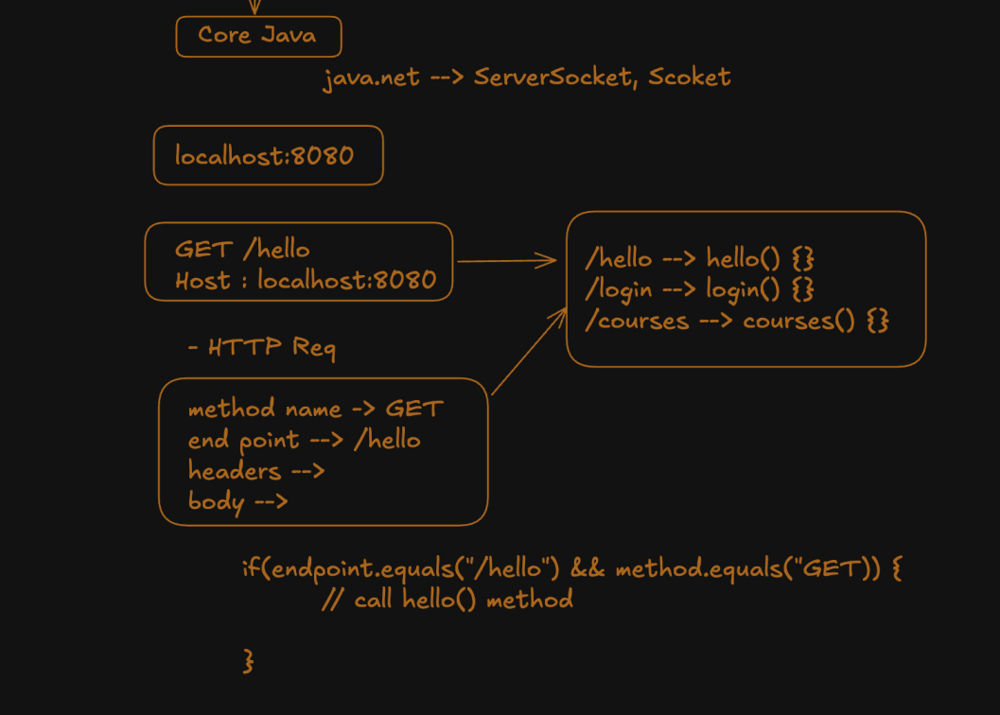
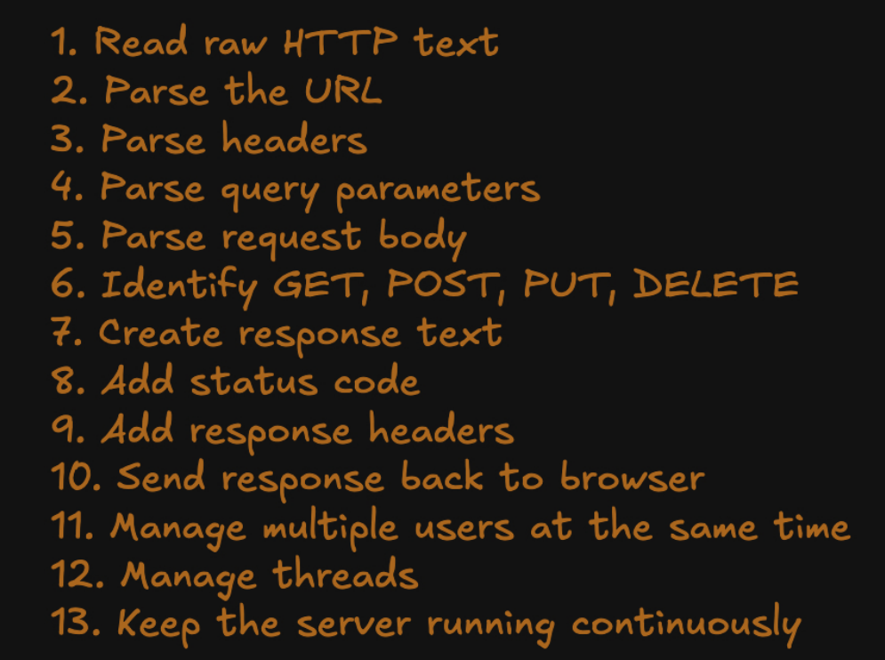
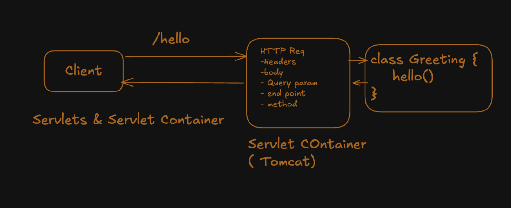
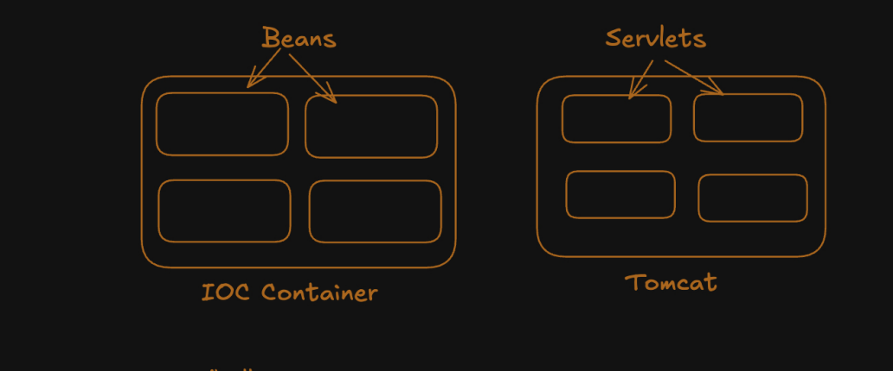
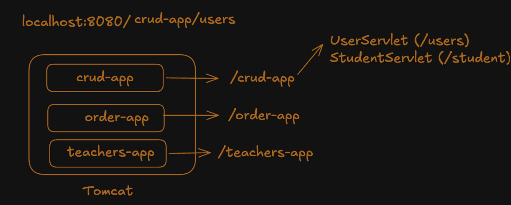
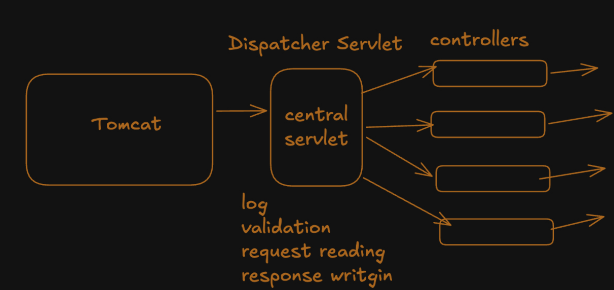

## @Entity 
@Entity is simply tells that the below class fields maps to table of some db and its objects will be mapped to rows of the table.  
@Entity also requires a no args constructor similar to jackson to create objects and the data are injected through reflections or field.

### Request Flow to controller 
Request with JSON data, it is converted into java object. and @Valid makes validation checks and after that it proceeds to controller

### How Jackson Converts JSON to java object
It creates object with No Arguments Constructor and injects with setters or fields.  
So NoArgsConstructor is necessary and setters are good practise. (Jackson can access privates through reflections(need not to think for now))


## Methods provided by Spring JPA (jakarta persistence api)
1. create/read -> save()
2. search many or one-> findAll() and find()
3. delete -> deleteById()
4. exists -> existsById()

### Why a interface in repository layer ? 
if there would be a class we have to manually write the query logic. Interface we define. common signatures are already provided like (listed above).
and custom method signatures we define inside interface.
at runtime JPA provides us the implementation of the repository layer methods implementations.

### Error when running newly created spring app due to @AutoConfig of database connection ?
@SpringBootApplication(exclude = {DataSourceAutoConfigiration.class})

### Configuration of application.properties for DB connection 
```text
spring.datasource.url=`url`/dbname
spring.datasource.username=***
spring.datasource.password=***
spring.jpa.hibernate.ddl-auto=***

spring.jpa.show-sql=true
spring.jpa.properties.hibernate.format_sql=true
```

## Pagination in Spring Boot

* Insted of Querying everything, we take required chunks using pagination
* With Query Params we can control how the chunk can be displayed (Filter, sort, etc)
* @PageableDefault is default values when Queryparams are not sent

```java
@GetMapping("/data")
public Page<DataDTO> getPaginatedData
(@PageableDefault(size = 10, sort = "fieldName", direction = Sort.Direction.ASC) Pageable pageable) {
 return dataService.getData(pageable); // Delegates pagination to the service layer
}
```
For Soft delete + pagination in Repository layer
```java
Page<Student> findByIsDeletedFalse(Pageable pageable); // isDeleted is Boolean in Entity
```
Rule of thumb is use JPA Naming as you were using before, To introduce pagination just pass Pageable class in parameter in Spring JPA Repository.

For Configuration in application.properties for default and max page size
```text
spring.data.web.pageable.default-page-size=20
spring.data.web.pageable.max-page-size=200
```


## Core Java For Web Applciations 

Applications can be made in core java, Everything is manual even before you write a single line of code of business logic   
Main/Core Problems :   

* Understanding the HTTP request (Metod, Path, Headers, Body) its just a stream, i.e String
* Mapping Route to Correct Method. Huge Else if Ladder



### Problems when Core Java



### Servlets and Beans  
before servlet and servlet container, servlets are special java class objects whom servlet container manages and invokes upon a request. This idea of Inversion of control leads to spring IOC container and beans.  
* Servlet is java class that handles HTTP request and generates HTTP response
* Servlet container creates, manages, Invokes servlets, manages their life cycle (init(), service and inside doGet() etc, destroy())
* Insted of you controlling (creating, Invoking, destroying) the servlet The control is Inversed to Tomcat.



Beans and servlets are similar cuz both are created and managed by servlet container/spring. And to reduce further tight coupling Dependency injection is added. in evolution of servlet & servlet container to spring core.  



## JAR vs WAR ( Java Archives vs Web Archives )

War packaging is used with servlets, the application's compiled code, dependencies and resources like (HTML, css, js files) are packaged, usually war is used to be deployed in external tomcat server. War is servlet class based.

Simple JAR is similar to WAR but JAR can be Executable JAR that can contains your compiled code, Embedded Tomcat JAR as well. and is standalone executable.

### External Tomcat 
We can deploy more than one application in external tomcat and to communicate the route is 
`http://localhost:8080/app-name/route-starts-here`


* This External tomcat upons request calls init() initially (similar to @PostConstruct)
* Then service() which internally resolves to some method like doGet, doPost etc.
* Then destroy() is called similar to @PreDestroy

### Simple code Example for Servlets 

```text
In pom.xml,

<packaging>war</packaging>

<build> <!--  As Name is hectic use this for deploying in Tomcat. -->
    <finalName>servlets</finalName>
</build>

Tomcat 9 or below
<dependency>
            <groupId>javax.servlet</groupId>
            <artifactId>javax.servlet-api</artifactId>
            <version>4.0.1</version>
            <scope>provided</scope>
</dependency>
Tomcat 10 or above You can use Jakarta Servlet API from MVN repo.
```


```java
package dev.arbaz;
import tools.jackson.databind.ObjectMapper;
import javax.servlet.annotation.WebServlet;
import javax.servlet.http.HttpServlet;
import javax.servlet.http.HttpServletRequest;
import javax.servlet.http.HttpServletResponse;
import java.io.IOException;

@WebServlet("/home")
public class DemoServlet extends HttpServlet{

    @Override
    public void doGet(HttpServletRequest request, HttpServletResponse response) throws IOException {
        Integer name = Integer.valueOf(request.getParameter("name"));
        response.getWriter().write(name + "The Response");
    }
    @Override
    public void doPost(HttpServletRequest request, HttpServletResponse response) throws IOException{
        Integer name = Integer.valueOf(request.getParameter("name"));
        ObjectMapper mapper = new ObjectMapper();
        User user = mapper.readValue(request.getReader(), User.class);

        response.getWriter().write(user.getId() + " " + user.getName() + " The Response");
    }
}
```

### Deploy to External Tomcat server 

* We can Install Tomcat from `https://tomcat.apache.org/download-90.cgi` and download from `32-bit/64-bit Windows Service Installer (pgp, sha512)`  
* Generally the path where Tomcat is located is 
`C:/Program Files/Apache Software Foundation/Tomcat 9.0/`  
First paste the .war packaged app into /webapps and New folder is automatically generated then:  
* To Run or start the server with out logs we can do from run (win + r) then `services.msc` and search tomcat and right click and start/stop.
* For logs as well, open Terminal navigate to the above path (use cd "Program Files/" use " ") and run ./bin/startup.bat or ./bin/shutdown.bat


### Purpose of Dispatcher Servlet 

Servlet container does a lot of work to reduce boiler plate, Tightly coupled code. Why a seperate dispatcher bw servlet and its container?  

* Some times when parsing request or generating response you might need to interact with spring.
* Example for that is say form HTTPServletRequest converting request body to object it needs Jackson bean.
* Spring placed a dispatcher servlet and introduced controllers.



* Its Like Tomcat manages (Parsing) Reqest to HttpServletRequest and forwards to Dispatcher servlet and same for response.   
* Dispacher Servlet manages HttpServletRq to Objects,Forwarding to correct controller (before tomcat does this in servlets) and Generating JSON response from spring response.  
* From Controllers the request can navigate to business logic (Service and Repository).   

* So it will be clear if me map to methods (base route in class then in methods) insted of just to class (in servlets), To understand the spring code like @GetMapping, the invokation is in hands of dispatcher servlet, back then it was to classes so Tomcat does this.
* Dispatcher servlet -> {HttpServletReq to Object via beans, invoking methods by understanding @Annotations, generating JSON response body etc} so that it can understand spring code. and seperate of concerns and Embedded tomcat need not to take care of this.

So its like evolution from servlets and servlet container to servlet container -> dispatcher servlet -> controller/service beans.
