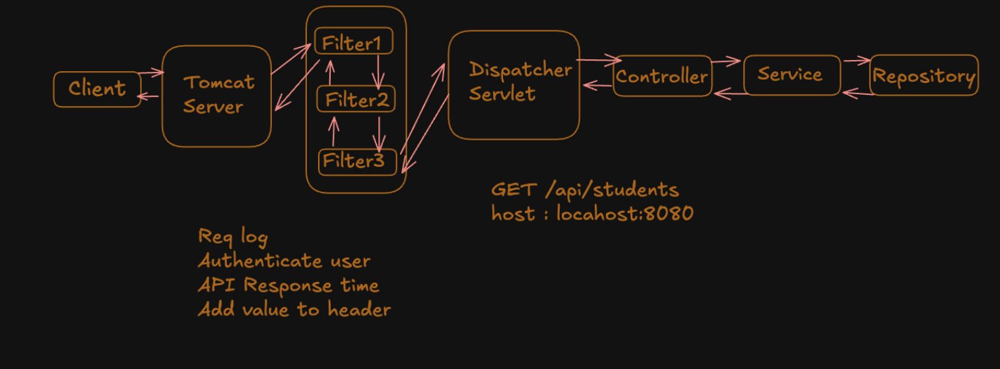
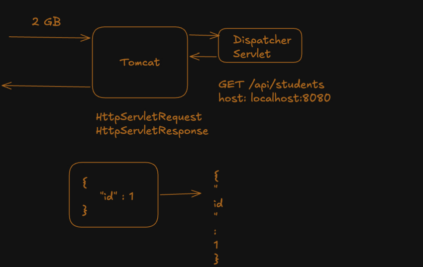
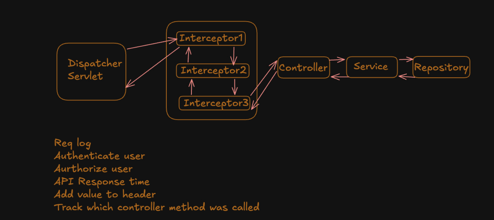
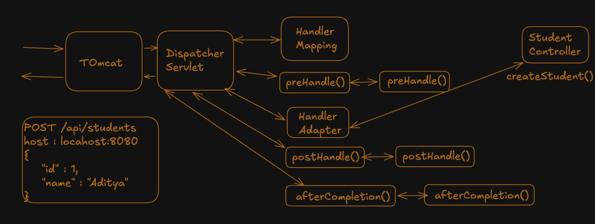
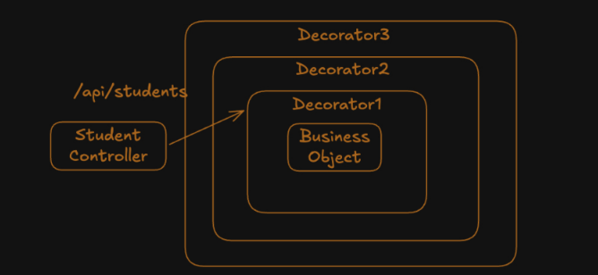
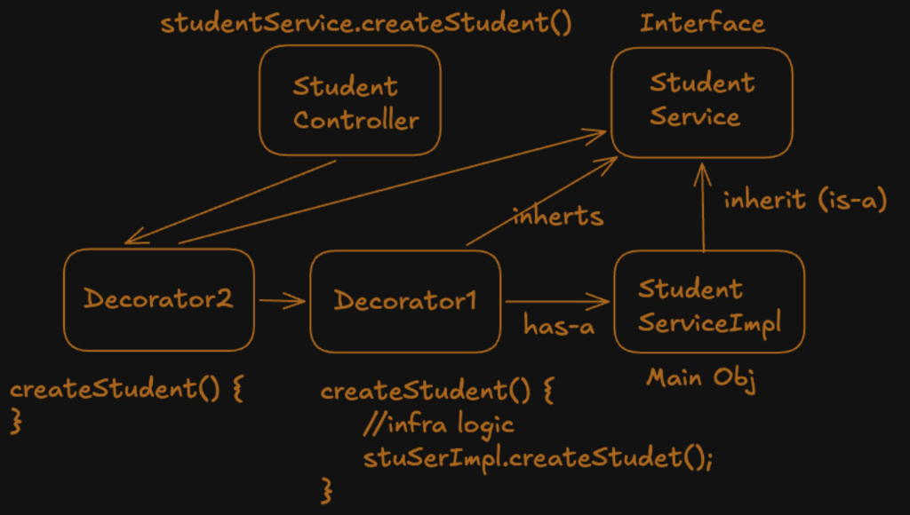
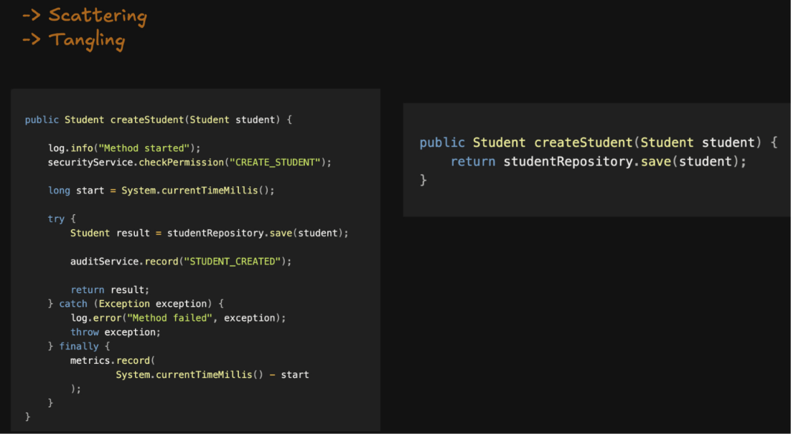
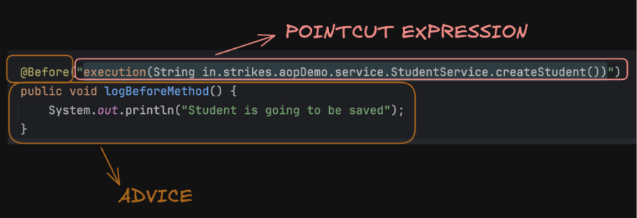
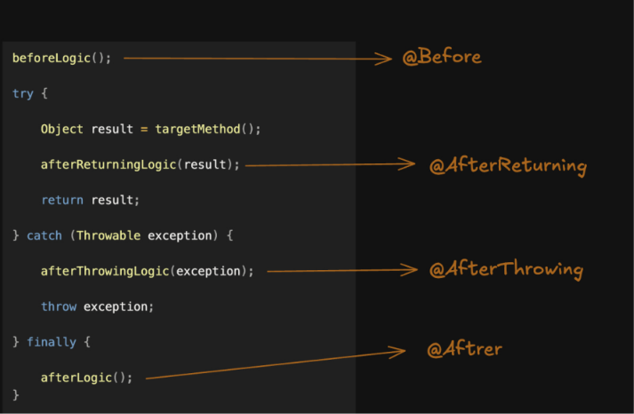

## Filters 

Filter is a component that intercepts HTTP request/response before dispatcher servlet.It acts as middleware between web server Tomcat and Dispatcher servlet.  
This Filter component is introduced in servlet and servlet-container period.  
What Filters are used for  
1. Inspect Request (Headers, Body, Cookies)
2. Check Authentication information
3. Add Response Headers
4. Modify request or response
5. Block/Allow the request
6. Log Request Details
7. Measure total request duration (Total time to serve)

### Position of Filter in Spring flow  
  


### Filter Lifecycle
- init() when filter is created. starting of app, this is not manditory
- doFilter() calling next filter when one filter has done its work
- destroy() when application is closing this destroy runs

Tomcat creates HttpServletRequest but the references are of ServletRequest in filter because they are general purpose and not limited to HttpRequests this might be there in servlets as well but the underlying object is HttpServletRequest.  

### Why cant we make changes in Response object after doFilter() ?

Dispatcher Servlet internally uses streams to populate the body. once stream is used then the response may be commited state (sent or started sending the response to user) 
`response.getWriter().write()` basically this line. better to set before.   

Recap : based on ResponseEntity class's object the dispatcher servlet populates the HttpServletResponse.   


### Input Stream in Filter 

If you try to read the input stream say for logging purpose httpservletresponse.getReader() say, then pass it in doFilter() you will get empty stream inside HttpservletResponse as stream is not stored it is continously flowing and its already consumed. so be careful on that.  

  

### Ways to declare Filters 
- OncePerRequestFilter Abstract class or You can implement Filter interface but Typecast ServletRequest to HttpServletRequest Manually

### Use of addUrlPatterns("/api/*") 
This can add some filter in chain only if the request pattern matches else the filter is not added in the chain for some request.   

The other way to achieve this is you maintain a chain and based on request you skip the filters.with help of if checks inside filter   
The difference is you enter the filter and skip through vs filter is not entered in first place.   `if(httpServletRequest.getRequestURI().startsWith("/api/")`  

## Interceptors

### Term Handler 
handler is a genric term refers to who handles the request, in rest it is controllers and in static resourses its ResourceHttpRequestHandler etc.   

Interceptors are like filters but they have addition information as we know which method of which controller is being called. because it is after dispatcher servlet. For Specilized task that is done in set of controllers we use Interceptors and genralized task for all the controllers we do use filters.   

As we Know the controller the Interceptors chain are like layers of onion peel.  
This helps in understanding The flow in the In-Depth Architecture.  

  

### Interceptor Methods 
- preHandle()
- postHandle()
- afterCompletion()

### postHandle() vs afterCompletion()
The difference comes when using JSP pages, in postHandle response(JSP pages) is not yet created, We can make final changes to Model Object that populates the JSP page later the response is created and sent to client later the afterCompletion runs.in REST Api's the differnece is NULL so we only use preHandle() and afterCompletion().


### Recap
handler mapping and adapter are also passed as beans (The ApplicationContext is passed) the dispatcher Servlet uses them.  
- Handler Mapping has mapping from route to class.method like, GET /users → UserController.getUsers()  
- Handler Adapter actually invokes by populating the params. it uses jackson to convert JSON <-> Java Obj and then populates.
- Both are Beans inside Application context and total application context is passed to dispatcher servlet.

   

### Clarity on Recap
Who converts the JSON <-> Java Object (Obv. Jackson Library) not dispatcher not Handler Adapter but the HttpMessageConverters they are used for conversions and invoked differently
- Request: `DispatcherServlet → HandlerAdapter → Argument Resolvers → HttpMessageConverter (JSON → Java object) → Controller`.

- Response: `Controller → HandlerAdapter → Return Value Handler → HttpMessageConverter (Java object → JSON) → DispatcherServlet → postHandle() → Response Is Ready, The HttpServletResponse population (as its there just popuation was pending) → afterCompletion() -> Sent to Tomcat `.

**When Dealing with REST Api's The response is converted in Handler Adapter i.e before postHandle() and In JSP pages it is after postHandle() Then the JSP page is ready and in the end the afterCompletion() is called and control/response is sent to Tomcat**  

Important: The response is already prepared before afterCompletion() in Both JSP/JSON specifically before postHandle.  

### Filters and Interceptors Practise code
```java

// AuthFilter.java
@Component
public class AuthFilter extends OncePerRequestFilter{
    @Override
    public void doFilterInternal(HttpServletRequest request, HttpServletResponse response, FilterChain chain) throws ServletException, IOException {
        String token = request.getHeader("token");
        String key = "12345";
        if(Objects.equals(token, key)){
            System.out.println("Passed through Auth Filter");
            chain.doFilter(request, response);
            return;
        }
        response.setStatus(404);
        response.getWriter().write("Invalid key");
    }
}

// LogFilter.java
@Component
public class LogFilter extends OncePerRequestFilter {
    @Override
    public void doFilterInternal(HttpServletRequest request, HttpServletResponse response, FilterChain chain) throws ServletException, IOException {
        System.out.println("Logging Filter");
        System.out.println("Request Method : " + request.getMethod() + "\n" + "Request route :" + request.getRequestURI());
        chain.doFilter(request, response);
    }
}

// FilterConfiguration.java
@Configuration
public class FilterConfiguration {
    public final AuthFilter authFilter;
    public  final LogFilter logFilter;
    public FilterConfiguration(AuthFilter authFilter, LogFilter logFilter){
        this.authFilter = authFilter;
        this.logFilter = logFilter;
    }
    @Bean
    public FilterRegistrationBean<AuthFilter> registerAuth(){
        FilterRegistrationBean<AuthFilter> registrationBean  = new FilterRegistrationBean<>();
        registrationBean.setFilter(authFilter);
        registrationBean.setOrder(1);
        return registrationBean;
    }
    @Bean
    public FilterRegistrationBean<LogFilter> registerLog(){
        FilterRegistrationBean<LogFilter> registerBean = new FilterRegistrationBean<>();
        registerBean.setFilter(logFilter);
        registerBean.setOrder(2);
        return registerBean;
    }
}

// AuthInterceptor.java
@Component
public class AuthInterceptor implements HandlerInterceptor {

    @Override
    public boolean preHandle(HttpServletRequest request, HttpServletResponse response, Object handler){

        if(handler instanceof HandlerMethod method){
            System.out.println("Entered Auth Interceptor");
            if(method.getBeanType() == Api.class){
                String token = request.getHeader("tokens");
                if(Objects.equals(token, "1234")){
                    System.out.println("Passed through Auth Interceptor");
                    request.setAttribute("temp", true);
                    return true;
                }else {
                    response.setStatus(HttpServletResponse.SC_UNAUTHORIZED);
                    return false;
                }
            }
        }
        return true;
    }
    @Override
    public void afterCompletion(HttpServletRequest request, HttpServletResponse response, Object handler,
                         @Nullable Exception ex) throws Exception {
        System.out.println("After completion of Interceptor");
        if((boolean)request.getAttribute("temp")){
            System.out.println("Interceptor True");
        }
    }
}

// LogInterceptor.java
@Component
public class LogInterceptor implements HandlerInterceptor {
    @Override
    public boolean preHandle(HttpServletRequest request, HttpServletResponse response, Object handler){
        if(handler instanceof HandlerMethod method){
            System.out.println("Entered Logging Interceptor");
            if(method.getBeanType() == Student.class){
                request.setAttribute("time", System.currentTimeMillis());
                System.out.println("HTTP Method: " + request.getMethod());
                System.out.println("Request URI: " + request.getRequestURI());
                System.out.println("Request Paramters: " + request.getQueryString());
                System.out.println("Client IP: " + request.getRemoteAddr());
                System.out.println(method.getMethod().getName() +
                        "\n" + method.getBeanType().getSimpleName());
            }
        }
        return true;
    }
    @Override
    public void afterCompletion(HttpServletRequest request, HttpServletResponse response, Object handler,
                                @Nullable Exception ex) throws Exception {
        System.out.println("Interceptor outer");
        Object temp = request.getAttribute("time");
        if(temp != null){
            System.out.println("Time " + (System.currentTimeMillis() - ((long) temp)) + " ms");
        }

        System.out.println("Response status: " + response.getStatus());
    }
}

// InterceptorConfiguration.java
@Configuration
public class InterceptorConfiguration implements WebMvcConfigurer {
    public final AuthInterceptor authInterceptor;
    public final LogInterceptor logInterceptor;

    public WebConfiguration(AuthInterceptor authInterceptor, LogInterceptor logInterceptor){
        this.authInterceptor = authInterceptor;
        this.logInterceptor = logInterceptor;
    }

    @Override
    public void addInterceptors(InterceptorRegistry registry){
        registry.addInterceptor(logInterceptor)
                .order(2);
        registry.addInterceptor(authInterceptor)
                .addPathPatterns("/api/**")
                .excludePathPatterns("/api/auth/**")
                .order(1);
    }
}

// Student Controller
@RestController
@RequestMapping("/students")
public class Student {
    @GetMapping
    public ResponseEntity<String> greet(){
        return ResponseEntity.status(HttpStatus.OK).body("Hello");
    }
}
// Api controller
@RestController
@RequestMapping("/api")
public class Api{
    @GetMapping
    public ResponseEntity<String> greet(){
        return ResponseEntity.ok("Validation success");
    }
}
```

### Where Interceptors shine
You can write one reusable interceptor and dynamically execution its logic based on controller metadata and custom annotations.  

### Creation of custom annotations 

```java
@Target(ElementType.METHOD) // Specifies where it can be applied (Methods)
@Retention(RetentionPolicy.RUNTIME)  
public @interface TrackExecutionTime {
}
```
* @Target(ElementType.Method)
  * target Tells us that it can be applied on Methods.
* @Retention(RetentionPolicy.RUNTIME)
   * tells Java to store the annotation information in the compiled .class file, so the Reflection API can read it while the program is running. This applies to any annotation marked with RUNTIME retention.


### Aspect Oriented Programming

Aspect Oriented programming is used to intercept the Method call. its like performing some task before or after a Method. similar to Interceptor to controller and Filters to Dispatcher servlet. Mainly we use this AOP in service layer Methods for Cross-cutting concerns.  

For a normal class its methods scale down, that means methods belong to its own class (Business logic). some tasks scale horizontally, there are present in many class (Infra code Like logging, Execution Time calc, Security etc) They are cross-cutting concerns. This helps decide what task to be wrapped in proxy object or not.

The proxies implementation is this Decorator pattern or Proxy pattern? Both are same but the different is intent That is if you are providing layer by layer functionality better to call Decorator pattern, when controlling a object (may allowing request to pass, security etc ) through a middleman object (proxy) to target object, so any of the above can be called.  
  

**Note: Calls involving `this` same class Method calls bypasses Spring proxy**

### Why AOP when we have Interceptors and Filters
They work around HTTP Lifecycle, But for business logic it may be called another method of business logic, some scheduled task etc. Spring AOP intercepts method calls that go through Spring's proxy to solve the problem of cross-cutting concerns.  


Then why use of Interceptors ? They work at controller layer and this in service layer ! The core reason is seperation of responsibilities so we use AOP's.  

When It revolves around HTTP request prefer Interceptor and whe its better as method related then AOP is better.
1.Interceptor Ask: Does this logic exist because an HTTP request is happening?
2.AOP Ask: Should this logic execution whenever a particular method is called, regardless of who calls it?

AOP isn't restricted to the service layer. But seperation of concerns we use accoring to above.

### Where it All started ?
The problem is This the cross cutting concerns    

The solutions include like using of seperate wrappers and take them as dependency, still lot many problems, one might forget, scalability issues etc. use of decorater/proxy pattern, implementation and maintaining is hard, maintaining proxy objects and layers and the correct flow is hard so spring takes care of that and internally its proxy/decorator pattern
### Before vs after AOP's   


### 3 Questions for AOP
- when (When to call proxy @Before, @AfterReturning, ...)
- where (The absolute path to func call with same params and return type)
- what (the Logic)

`what` and `when` combined are called as Advice and where `where` as pointcut.    
`what` and `where`  combined are called as Aspect   



### Flow of an AOP request  


### The @Around Annotation 
it is the main powerful AOP that can actally mutate the req and/or response object before or after req, and when we do `ProceedingJoinPoint req` and when req.proceed() the req will not move forward.

Sample practise code
```java
 @Around("execution(String dev.arbaz.aops.service.BankService.withdrawl(String,Integer))")
    public String logAround(ProceedingJoinPoint joinPoint) throws Throwable {
        Long beforeTime = System.currentTimeMillis();
        Object[] args = joinPoint.getArgs();
        String name = (String) args[0];
        name = "Guest " + name;
        Object[] newArgs = {name, args[1]};

        try{
            Object response = joinPoint.proceed(newArgs);
            String newResponse = ((String) response) + " inr";
            System.out.println("Sending response to " + name + " " + newResponse);
            return newResponse;

        }catch(Throwable ex){
            throw ex;
        }finally{
            Long duration = System.currentTimeMillis() - beforeTime;
            System.out.println("Withdraw Request took " + duration + "ms");
        }
    }

    @Before("execution(String dev.arbaz.aops.service.BankService.withdrawl(String,Integer))")
    public void logBeforeWithdraw(JoinPoint joinPoint){
        Object[] args = joinPoint.getArgs();
        String name = (String) args[0];
        Integer amount = (Integer) args[1];
        System.out.println(name + " Request to Withdraw " + " " + amount);
    }
    // @AfterReturning(value = ...,  returning = "var_name_in_params")
    @AfterThrowing(value = "execution(String dev.arbaz.aops.service.BankService.withdrawl(String,Integer))",
            throwing = "exception")
    public void logAfterThrowingWithdraw(JoinPoint joinPoint, Throwable exception){
        Object[] args = joinPoint.getArgs();
        String name = (String) args[0];
        System.out.println("Exception For User " + name + " " + exception.getMessage());
    }
    // @After similar to finally block evecutes even when AfterReturning (success) or AfterThrowing (failure)
```

JoinPoint - Gives the information of the Method that will be called after the proxies.   
ProceedingJointPoint - The Child class that can perform .proceed() to forward the request.

### The @Around Method
The actual wrapper that can change request Parameters and response data, when joinPoint.proceed() Then the cycle starts
```text
@Around: when we before of joinMethod.proceed() then
    | proceed()
    v
@Before
    |
Service method
    |
@AfterReturning (or @AfterThrowing)
    |
@After
    |
    v
@Around: After everything (just below the joinMethod.proceed)
```

### Proxy Recap
So proxy in spring is a middleman func that intercepts the call before going to a target function, there exists only one proxy and it can have many advices (can be vizualized as onion peel) that reaches the terget method !

### Pointcut Expression 

We can use 2 wild cards to make a generic advice that can be used to intercept all the common targets, we have * and .. wildcards, * means a single level anything and .. means all further levels.  

Structure of a point cut: `PointCutMethod(AccessSpecifier ReturnType FullPathToTargetBasedOnMethod(SignatureOfArgumentsOfThatMethod) )`  public access specifier can be ignored.  

- Most common is exectute() this is for Methods, `execution(* dev.arbaz.in.service.BankService.MethodName(*, Integer, *))` like wise we write a pointcut.   
- we can use * for method name - `execution(* dev.arbaz.in.service.BankService.*(*, Integer, *))` like wise we write a pointcut.  
- or we can use for Service Folder's all classes level as well (direct classes as last * in execution represents a method so nested classes cannot be targeted): `execution(* dev.arbaz.in.service.*.*(*, Integer, *))` like wise we write a pointcut.  

Usage of .. wildcard  
- For any number of arguments `execution(* dev.arbaz.in.service.BankService.MethodName(..))` like wise we write a pointcut.
- as last * is Method name in execution and I intend to target all classes of service (even in sub packages): `execution(* dev.arbaz.in.service..*(..))`
- Usage of && and || operators in conditioning inside PointQuery method  

Eg:  `@Before("within(in.strikes.Service) && execution(* * (..))")`   (Means any retrurn type, targets all classes's methods, and any params inside Service)   

### Types of PointCut expression Methods 

