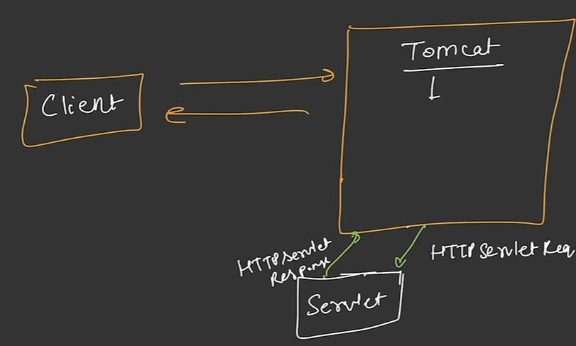
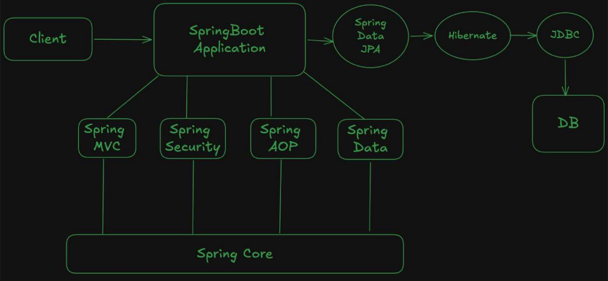
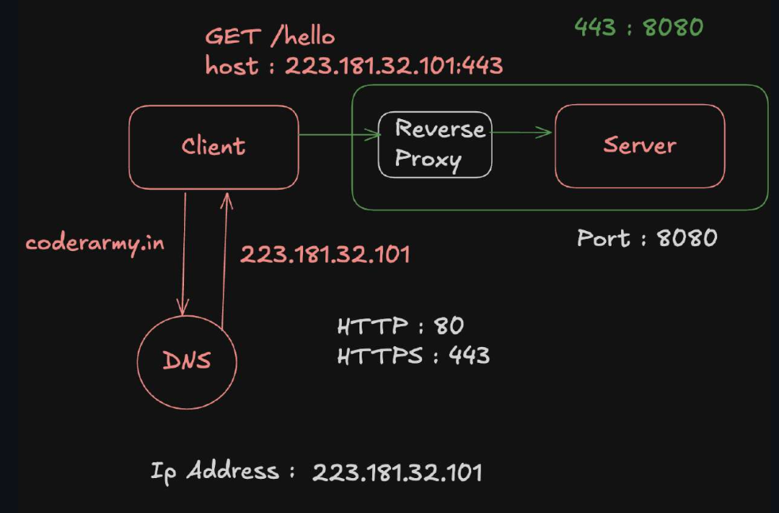

## Client Server Architecture

**Clients** (Browser, Mobile App, postman, server as well can be clients) communicate with servers for response  
* HTTP is standred protocol (Rule book, Guidelines, Standardization for communication) for Requests and Responses  
  * Request Structre (Method,Host, Path, Http Version, Headers, Body)
  * Response Structure (Status code, Headers, Body)
  * Meaning of GET, POST etc
  * How the data is sent (HTTP / HTTPS)

---

## Why not use Core Java ?

**Core Java** can be used to build applications, with help of sockets and server sockets that listen to some port (core java functionality)  
Listening a network request on a port 
```java
ServerSocket server = new ServerSocket(8080);
```

### Problems Which make Development very hard in core Java
* Java Sockets read request in form of streams i.e manual conversion into HTTP Request and Response
* Manual URL / Route Parsing 
* Mapping a method to an endpoint route 
  * Huge Else if Ladder for Mimicing conroller
* This all is done through main thread and other requests have to wait, manual multi threading has to be done.
* Huge Boilerplate code to be written

## Introduction of servets and servlet containers

**Servlet container** we call it as **Server** This also listens Networking request but also performs the Stream to HTTP conversion and boilerplate problem
* Calls Appropriate Servlet for a route (Mapping problem)
* Manages Threads (No manual Multithreading)
* Tomcat is famous servlet container. keeps listening for requests.

* servlet container calls servlet based by parsing the route (eg /api/login) and chooses servlet 
* Servlet is Java Class which handles request one request is sent to servlet (Class basically)
  * GET  → doGet()
  * POST → doPost()
  * PUT  → doPut()
  * DELETE → doDelete()



## Problems and Need for Spring Framework

> When Servlet code is scaled to some enterprise level, The code is tightly coupled. 
* Manual creation of objects  
* Controlling the flow of execution 
* Changing a existing code feature would require touching code in large codebase, breakage and expensive bug fixes
All these make code Tightly coupled

## Spring Core 
It is Concept, Ideology (Dependency Injection, Inversion of control, Beans) Assumes a Configuration reduces boilerplate problem further 
solution to Tightly coupled problem.  
The spring MVC, Spring Data, Spring security all are based on spring core 

## Spring Boot 
This is Opinionated system (provides default config), This is build upon the services (Spring MVC, Spring data..)
* Internally uses servlets and modren spring a single servlet exists for req and response handeling (Evolution from many servlets to one)
* from Dispatcher Servlet the request enters Spring MVC.
* some other sevlets like default servlet for static (HTML, CSS) files and custom servlets etc.




### Port 
Just as IP address is used to identify device, Port number is used to identif application inside device.  
socket is object maintained by os which has port mapping and related information.  

### Dependency
library On which my code depends becomes my Dependency. External library required by my project 

### JAR Packaging - (Java Archive)
Containes Our code as well as setup code to run our application, so that we can have communication between server and application.

## Proxy
A server That sits beteween another server and forwards requests
* Forward proxy or proxy
* Reverse Proxy

``` text
Client -> Proxy -> server  
```
if proxy is working for user its forward and if its working for backend its reverse proxy  


Main Use cases of proxy:
* We configure Proxy for many clients so that we can Hide internal Ip's and this only represents the ip of proxy  
* Controlling what clients can request for
* Caching between requests of clients  

Simple reverse proxy is also the same 
``` text
Client -> Proxy -> server  
```

Main Use cases of reverse proxy:  
* It works for server, Hides the ports of backend Server, Topology i.e how backend is organized.
  * **DNS contains domain to Reverse proxy IP not servers** so that the rules can be enforced and actual ip is hidden.
  * core usecase of proxy is to make attackers/users cannot directly connect to your backend service and bypass the proxy's controls.
* Decides what server to handle a request. and also acts as load balancer if more instances are there.
* HTTPS encrption and decrption and forwards HTTP request.
* Rate Limiting
* Caching of responses that include (Static files like images, CSS, JS).


if Huge Application we can use multiple Reverse proxies and load balancer 
``` text
Clients
   ↓
Load Balancer
   ↓
RP1   RP2   RP3
 ↓     ↓     ↓
Backend servers  
```
Reverse proxy do jobs like caching, rate limiting, load balancing, Routing (configuration if its microservice)
Load is further reduced for Reverse proxies with load balancer and no need for extra activities on above layer so dedicated load balancer is enough and suggested.

## Client server detailed 

